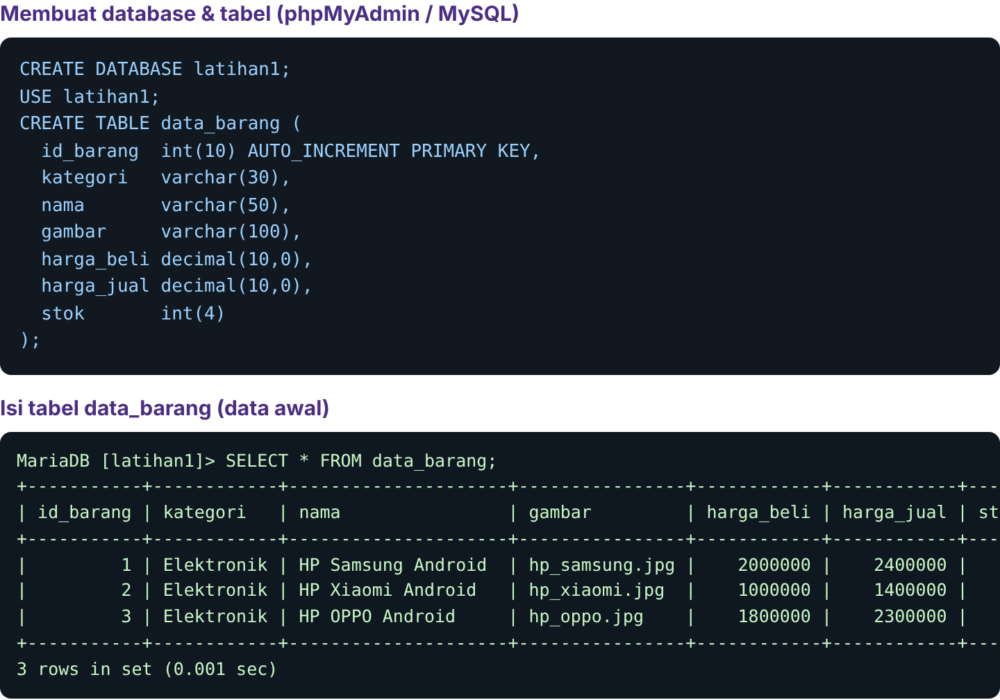
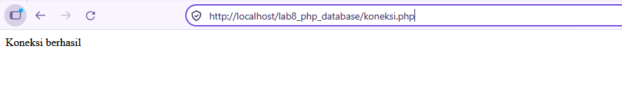
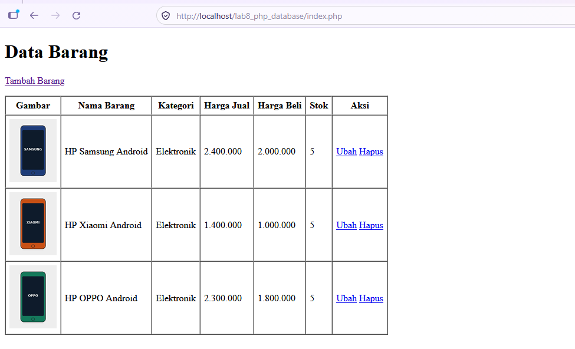
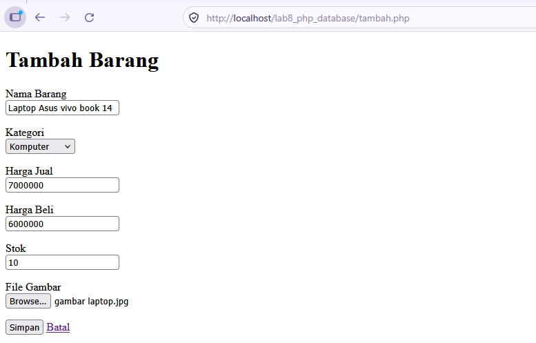
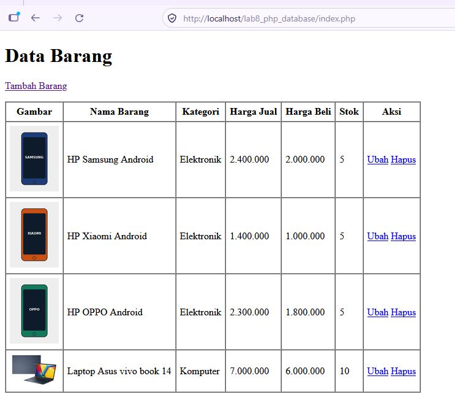
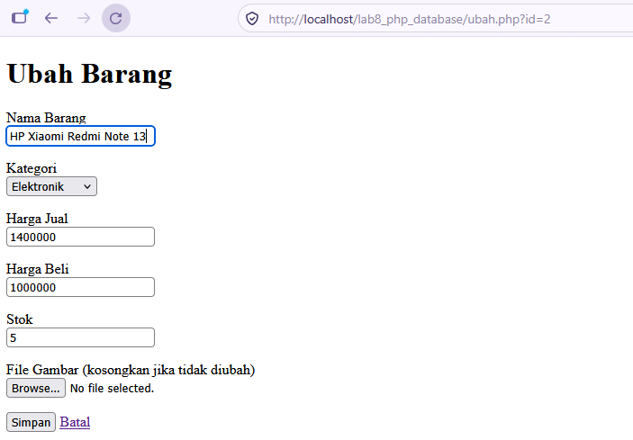
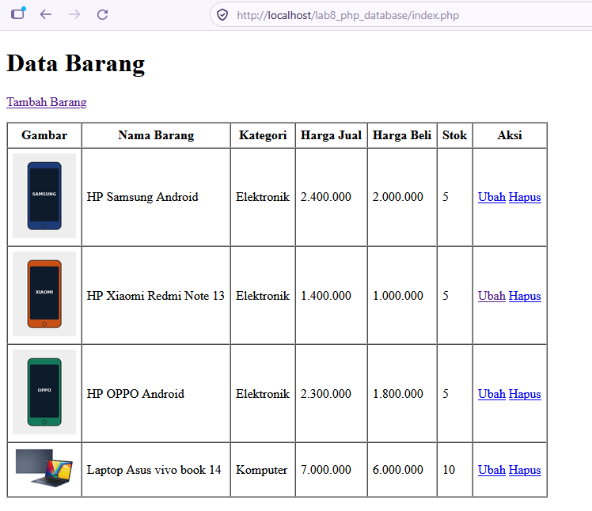
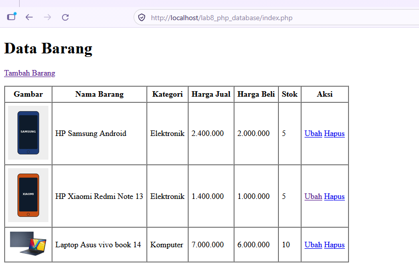

# lab8_php_database — Praktikum 8: PHP dan Database MySQL

Aplikasi **CRUD** (Create, Read, Update, Delete) sederhana untuk data barang menggunakan **PHP** dan **MySQL (MariaDB)**. Dibuat **tanpa CSS** (HTML polos) agar fokus pada logika PHP dan operasi database.

**Identitas:** Syafri Prayogo — 312510500 — TI.25.C.3

## Perangkat

- XAMPP/Laragon (Apache + MySQL/MariaDB + PHP 8), atau server bawaan PHP + MySQL.
- phpMyAdmin untuk mengelola database.
- Visual Studio Code & web browser.

## Struktur File

```
lab8_php_database/
├── koneksi.php        # Koneksi ke database (mysqli)
├── index.php          # READ — menampilkan data barang (tabel)
├── tambah.php         # CREATE — form tambah + upload gambar
├── ubah.php           # UPDATE — form ubah data (prefill)
├── hapus.php          # DELETE — hapus data berdasarkan id
├── database.sql       # Skrip membuat database, tabel, & data awal
├── gambar/            # Folder gambar barang (hp_samsung.jpg, dll)
├── screenshots/       # Hasil screenshot tiap langkah
└── README.md
```

## Cara Menjalankan

1. **Jalankan Apache & MySQL** dari XAMPP Control Panel.
2. **Buat database:** buka `http://localhost/phpmyadmin/`, lalu import `database.sql`
   (atau jalankan isinya pada tab SQL). Ini membuat database `latihan1`, tabel
   `data_barang`, dan 3 data awal.
3. **Salin folder** `lab8_php_database` ke `htdocs` (XAMPP).
4. Buka `http://localhost/lab8_php_database/` di browser.

> Alternatif tanpa XAMPP: jalankan MySQL, lalu dari dalam folder `php -S localhost:8000` dan buka `http://localhost:8000/`.

**Konfigurasi koneksi** (`koneksi.php`): host `localhost`, user `root`, password kosong, database `latihan1` — sesuaikan bila berbeda.

## Konsep CRUD

| Operasi | File | Perintah SQL |
|---|---|---|
| **Create** | `tambah.php` | `INSERT INTO data_barang ...` |
| **Read** | `index.php` | `SELECT * FROM data_barang` |
| **Update** | `ubah.php` | `UPDATE data_barang SET ... WHERE id_barang = ...` |
| **Delete** | `hapus.php` | `DELETE FROM data_barang WHERE id_barang = ...` |

---

## Dokumentasi Screenshot

> Untuk mengganti dengan tangkapan layar sendiri, timpa file di folder `screenshots/` dengan nama yang sama.

### Membuat Database & Tabel


### Tes Koneksi (koneksi.php)
Dengan meng-*uncomment* `echo "Koneksi berhasil";` pada `koneksi.php`.


### READ — index.php (menampilkan data)


### CREATE — tambah.php (form)


### CREATE — setelah menambah "Laptop ASUS"


### UPDATE — ubah.php (form prefill)


### UPDATE — setelah mengubah data Xiaomi


### DELETE — setelah menghapus "HP OPPO Android"


---

## Catatan Keamanan

- Input difilter dengan `mysqli_real_escape_string()` sebelum dimasukkan ke query untuk mengurangi risiko SQL Injection.
- Upload gambar memakai `move_uploaded_file()` dan nama file dirapikan dengan `str_replace(' ', '_', ...)`.
